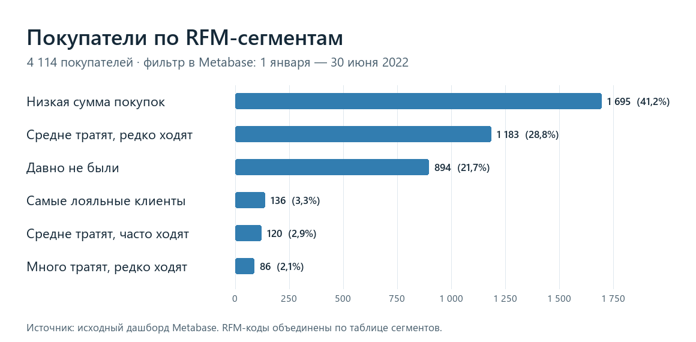
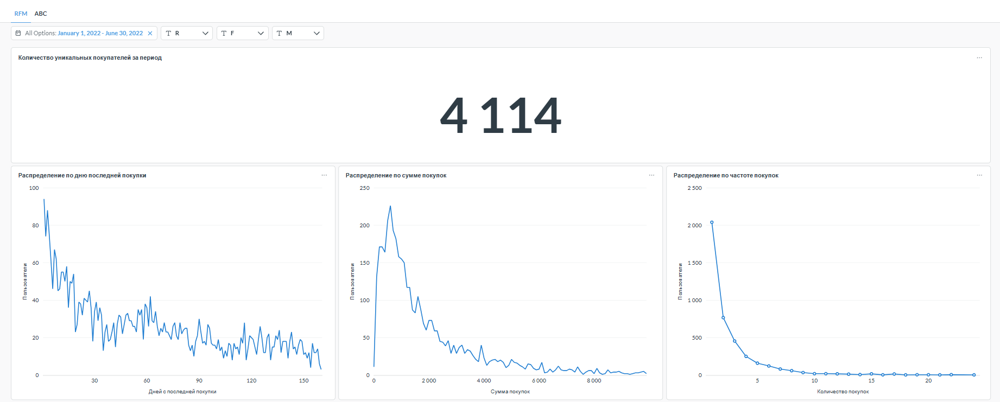
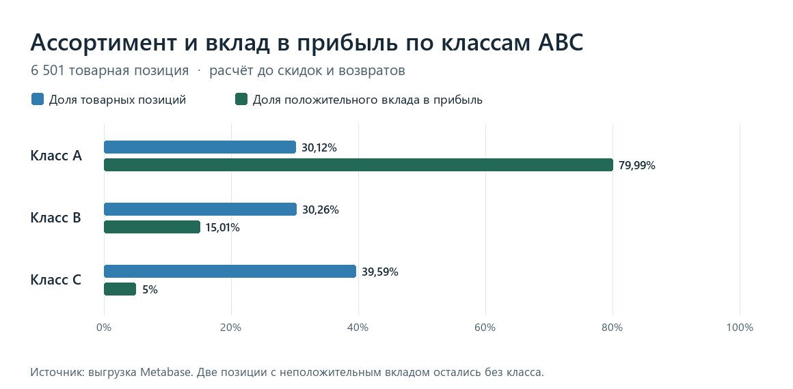

# RFM-сегментация клиентов и ABC-анализ ассортимента аптечной сети

## Бизнес-задача

Перед ожидаемым сезонным спадом аптечная сеть планировала поддержать выручку с помощью персонализированных СМС-рассылок. У сети уже был канал рассылки. Нужно было определить, кому отправлять сообщения, какие предложения давать и как оценивать эффект с учётом затрат на СМС и скидки.

Предложение должно учитывать историю покупок. Например, клиента с одной недорогой покупкой стоит исключить из первого теста скидок на увеличение среднего чека. Для такого предложения перспективнее сегмент клиентов, которые уже покупают регулярно. RFM помогает выбрать аудиторию и задачу кампании, а ABC — отобрать товары для предложения с учётом их вклада в прибыль.

## Результат RFM-сегментации

При фильтре с 1 января по 30 июня 2022 года на дашборде Metabase отображалось **4 114 уникальных покупателей** и 25 наблюдаемых RFM-кодов. Для графика числа по кодам из дашборда объединены по таблице сегментов из раздела «Методика».

*RFM-дашборд в Metabase с распределениями покупателей по давности, частоте и сумме покупок.*

## Результат ABC по расчётной прибыли

В выгрузке Metabase класс A включал **1 958 из 6 501 товарной позиции (30,12%)** и давал **79,99% положительного вклада в прибыль до скидок и возвратов**. Эти позиции можно использовать как стартовый список для проверки наличия и расчёта экономики акции.

Две товарные позиции с отрицательным вкладом остались без класса. Они учтены в общем количестве позиций, по которому рассчитана доля ассортимента.

## Гипотезы для кампаний

Для каждой гипотезы основная метрика сравнивается между тестовой и контрольной группами. Период измерения начинается с распределения клиентов по группам.

| Сегмент | Покупатели | Гипотеза | Основная метрика |
| --- | ---: | --- | --- |
| Самые лояльные клиенты | 136 | Повышенное начисление баллов | **Валовая прибыль на клиента за 60 дней** — сумма валовой прибыли по покупкам за период / число клиентов в группе |
| Много тратят, редко ходят | 86 | Бонус за повторный визит | **Repeat purchase rate за 30 дней** — доля клиентов группы хотя бы с одной новой покупкой за первые 30 дней |
| Средне тратят, редко ходят | 1 183 | Бонус на следующую покупку | **Retention в дни 21–30** — доля клиентов группы хотя бы с одной покупкой в этом окне |
| Средне тратят, часто ходят | 120 | СМС с бонусом за покупку от заданной суммы | **AOV за 30 дней** — выручка после скидок / число чеков за первые 30 дней |
| Давно не были | 894 | Напоминание о накопленных баллах | **Reactivation rate за 30 дней** — доля клиентов неактивного сегмента хотя бы с одной покупкой за первые 30 дней |
| Низкая сумма покупок | 1 695 | Тест СМС без скидки среди клиентов, которые уже покупали повторно | **Конверсия в покупку за 30 дней** — доля участников теста хотя бы с одной покупкой за первые 30 дней |

Для гипотезы про AOV дополнительно отслеживается конверсия в покупку за 30 дней. Решение о масштабировании кампании принимается по разнице между тестом и контролем в валовой прибыли на клиента после вычета стоимости рассылки. В расчёт входят фактические скидки и все клиенты, распределённые по группам.

Для товарного предложения можно сначала отобрать позиции класса A по расчётной прибыли, а затем проверить наличие, ожидаемую прибыль после скидки и пригодность для конкретной кампании. Товарные продажи и чеки анализируются отдельно.

## Методика

### RFM

Единица анализа — цифровая карта. RFM рассчитывается по чекам до 10 июня 2022 года. Уникальный чек определяется по `doc_id`. Совпадающие записи учитываются один раз, а чеки с противоречащими данными исключаются. Оценка 1 соответствует наиболее благоприятному значению показателя.

| Показатель | 1 | 2 | 3 |
| --- | --- | --- | --- |
| R — дней с последней покупки | До 18 включительно | 19–62 | От 63 |
| F — уникальных чеков | От 7 | 2–6 | 1 |
| M — сумма покупок по полю `summ` | От 6 400 | Свыше 1 000, ниже 6 400 | До 1 000 включительно |

| Сегмент | RFM-коды |
| --- | --- |
| Самые лояльные клиенты | 111 |
| Много тратят, редко ходят | 121, 131, 221, 231, 331 |
| Средне тратят, редко ходят | 122, 132, 222, 232 |
| Средне тратят, часто ходят | 112, 212 |
| Давно не были | 211, 311, 312, 321, 322, 332 |
| Низкая сумма покупок | 113, 123, 133, 213, 223, 233, 313, 323, 333 |

### ABC

Для каждого товара рассчитываются количество проданных единиц, розничная стоимость и расчётная прибыль. Прибыль равна разнице между розничной и закупочной ценами, умноженной на количество. В анализ входят строки розничной реализации с положительным количеством и заполненными ценами. Расчёт выполнен до скидок и возвратов.

Для каждого показателя товары сортируются от наибольшего положительного вклада к наименьшему. Товары с нулевым или отрицательным вкладом в показатель выделяются в строку `unclassified`. Доли классов A, B и C считаются от суммы положительных вкладов.

Класс определяется по накопленной доле с учётом текущего товара. A — до 80% включительно, B — свыше 80% и до 95% включительно, C — свыше 95%. При равных значениях применяется сортировка по идентификатору товара.

## SQL-запросы

- Распределения для RFM-дашборда: [давность](sql/rfm_recency_distribution.sql), [частота](sql/rfm_frequency_distribution.sql) и [сумма покупок](sql/rfm_monetary_distribution.sql).
- RFM-отчёты: [коды по картам](sql/rfm_customers.sql), [число покупателей по кодам](sql/rfm_by_code.sql) и [сводка по шести сегментам](sql/rfm.sql).
- ABC-отчёты: [классы по товарам](sql/abc_products.sql) и [доли ассортимента и вклада по классам](sql/abc.sql).
